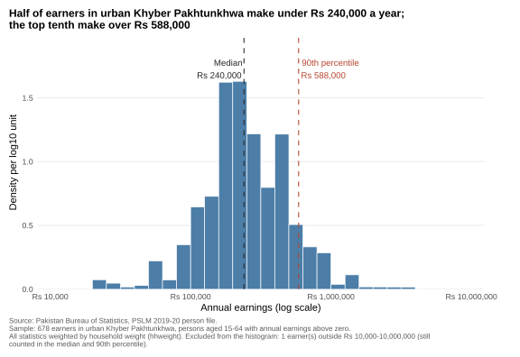
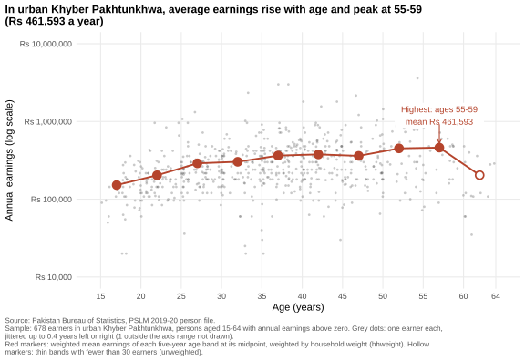
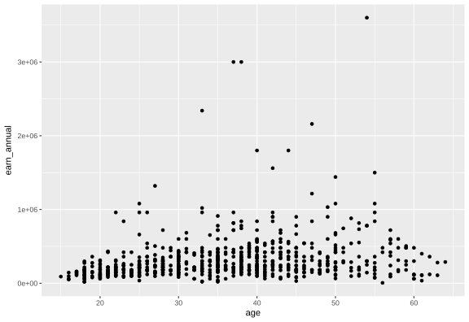
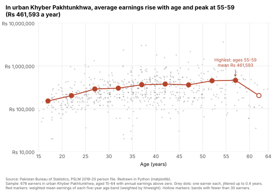

# ECO346 Assignment 1: Earnings in urban Khyber Pakhtunkhwa

**Registration number:** FA24-BEDS-037 · **Section:** A
**Variant:** 37 = 4 × 8 + 5, so **variant 5: Khyber Pakhtunkhwa, urban** (`prov_code == 1`, `urban_rural == 2`)
**Sample:** persons aged 15–64 with `earn_annual > 0` ("earners"), every statistic weighted by `hhweight`.
**Second language (Q5):** Python

## How to reproduce

From the repository root, with no internet needed (the data are in `data/`):

```
Rscript scripts/01_default.R          # Q4 default figure  -> figures/default.svg
Rscript scripts/02_distribution.R     # Q2 histogram       -> figures/distribution.svg
Rscript scripts/03_age_earnings.R     # Q3 redesign        -> figures/age_earnings.svg
python  scripts/04_age_earnings.py    # Q5 Python version  -> figures/age_earnings_python.svg
```

Each R script sources `scripts/00_setup.R`, which sets the variant, attaches `hhweight`, `prov_code` and `urban_rural` from the household file by `hhid`, builds the earners sample, and defines the weighted mean and the weighted quantile (the smallest *x* at which the cumulative weight share reaches or exceeds *p*). Every script prints the numbers reported below.

R packages: `dplyr`, `ggplot2`, `scales`, `svglite`. Python packages: `pandas`, `numpy`, `matplotlib`.

## Q2. The distribution



| Statistic | Value |
|---|---|
| Number of earners | 678 |
| Weighted median | Rs 240,000 |
| Unweighted median | Rs 240,000 |
| Weighted 10th percentile | Rs 108,000 |
| Weighted 90th percentile | Rs 588,000 |
| P90 / P10 | 5.44 |
| Excluded from histogram | 1 (one earner at Rs 5,000) |

**What it shows.** Earnings of urban KP earners are roughly log-normal, bunched between Rs 100,000 and Rs 600,000 with a long right tail: the top tenth earn over Rs 588,000, 5.44 times the bottom tenth's Rs 108,000. The weighted and unweighted medians are identical because earnings are heaped at round monthly amounts: about 4.9% of earners report exactly Rs 240,000 (Rs 20,000 a month), so both cumulative shares cross 50% inside that same spike.

## Q3. The relationship



| Age band | Earners (unweighted) | Weighted mean earnings |
|---|---:|---:|
| 15–19 | 35 | Rs 152,102 |
| 20–24 | 82 | Rs 203,196 |
| 25–29 | 89 | Rs 289,679 |
| 30–34 | 86 | Rs 303,177 |
| 35–39 | 118 | Rs 364,289 |
| 40–44 | 104 | Rs 377,476 |
| 45–49 | 65 | Rs 361,264 |
| 50–54 | 49 | Rs 451,343 |
| 55–59 | 35 | Rs 461,593 |
| 60–64 | 15 (thin) | Rs 203,724 |

- Weighted mean, band 25–29: **Rs 289,679**
- Weighted mean, band 45–49: **Rs 361,264**
- Band with the highest weighted mean: **55–59**

**Interpretation.** Average earnings rise steeply from Rs 152,102 at 15–19 to about Rs 364,000 by 35–39, flatten through the forties, and peak at Rs 461,593 at 55–59, three times the youngest band. This is the familiar concave age–earnings profile: experience pays most early in a career. The drop at 60–64 rests on only 15 earners, so it is weak evidence. Spread within every band dwarfs the change in means across bands. What the figure cannot tell us: whether one person's earnings follow this path, because this is a single cross-section that mixes age with cohort differences such as schooling.

**Transparency.** Points use `alpha = 0.3`. With 678 earners, single points stay visible, while earners stacked at the same age and the same round amount (Rs 120,000, Rs 240,000 a year) darken to near-solid where three or four overlap, so the heaps show.

## Q4. The makeover

Default (`ggplot(earners, aes(age, earn_annual)) + geom_point()`):



**Explaining the redesign.**
1. *Log scale.* On the default linear axis a few multimillion earners squeeze most people into the bottom fifth, labelled `1e+06`. A log axis spreads proportional differences evenly, labelled in rupees.
2. *Overplotting.* Integer ages and round earnings stack solid dots into columns. Transparency and jitter of at most 0.4 years reveal density.
3. *Conditional means.* The question is how earnings change with age, so I added weighted band means joined by a line, encoded by position, the most accurately read channel, in a strong colour over grey points.
4. *Data–ink.* I removed the grey panel and minor gridlines, put a finding in the title, annotated the peak directly, and stated sample and weights in the caption.

**What the default shows that the redesign hides:** how far the top earners sit above everyone in absolute rupees. The log scale compresses that distance.

## Q5. A second language (Python)



- Band 25–29 weighted mean, R: **Rs 289,679**
- Band 25–29 weighted mean, Python: **Rs 289,679**

All ten bands agree to the rupee (run `scripts/04_age_earnings.py` to print the table).

**Default that differed.** Matplotlib labels a log axis in powers of ten (10⁴, 10⁵, …) and adds unlabeled minor ticks, while ggplot prints the break values. I set a `FixedLocator` at 10⁴–10⁷, a `FuncFormatter` printing "Rs 10,000", and removed minor ticks. I also set `figsize=(8, 5.5)` to match `ggsave`, `alpha=0.3`, and white faces for thin bands. The jitter draws come from different random generators, so individual dots move slightly; the band table matches exactly.
